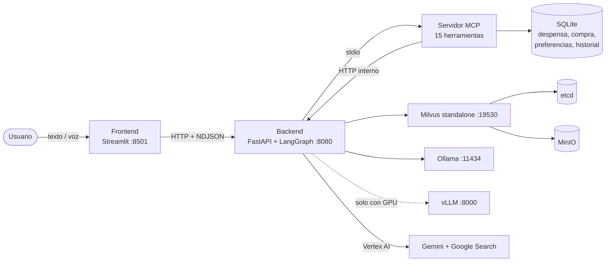
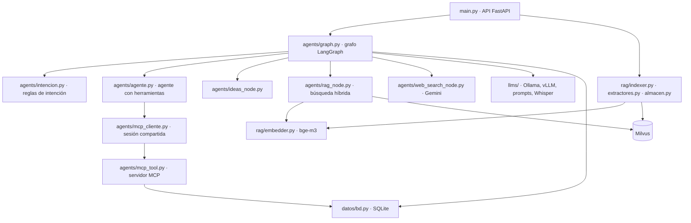
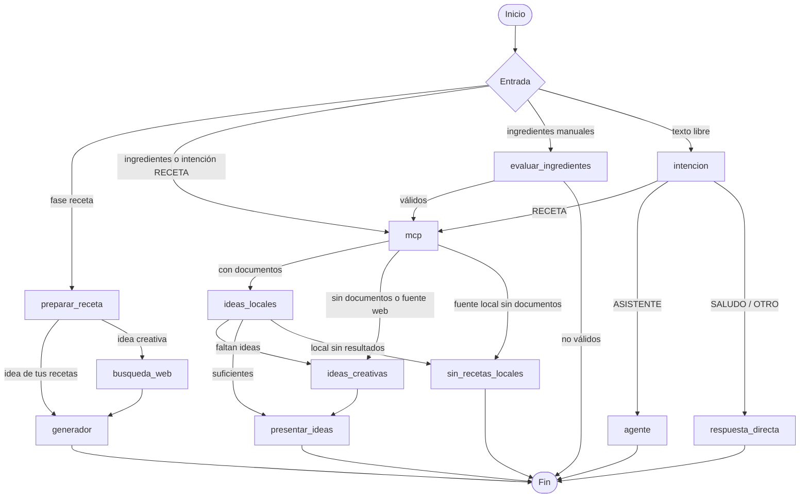

# 👨‍🍳 CookingAura

**Asistente de cocina multiagente** que conversa contigo por texto o por voz, conoce tu despensa, tus alergias y gustos, tu lista de la compra y lo que has cocinado, propone **ideas de platos** con lo que tienes y, cuando eliges una, genera la **receta paso a paso**.

Combina tus propias recetas (documentos indexados en una base de datos vectorial con búsqueda híbrida), ideas creativas generadas por un LLM y búsqueda en internet. Todo se ejecuta en local con Docker: los modelos de lenguaje corren en **Ollama** (CPU o GPU) o **vLLM** (GPU NVIDIA), la voz se transcribe con **Whisper** y la búsqueda web usa **Gemini** en Vertex AI.

---

## Índice

1. [Funcionalidades](#1-funcionalidades)
2. [Arquitectura](#2-arquitectura)
3. [Tecnologías](#3-tecnologías)
4. [Estructura del proyecto](#4-estructura-del-proyecto)
5. [Construcción y despliegue](#5-construcción-y-despliegue)
6. [Configuración (.env)](#6-configuración-env)
7. [Funcionamiento del asistente](#7-funcionamiento-del-asistente)
8. [El chat libre: agente y herramientas MCP](#8-el-chat-libre-agente-y-herramientas-mcp)
9. [El RAG: indexación y búsqueda de recetas](#9-el-rag-indexación-y-búsqueda-de-recetas)
10. [Datos y persistencia](#10-datos-y-persistencia)
11. [Interfaz (frontend)](#11-interfaz-frontend)
12. [API del backend](#12-api-del-backend)
13. [Herramientas de desarrollo y evaluación](#13-herramientas-de-desarrollo-y-evaluación)
14. [Rendimiento](#14-rendimiento)
15. [Solución de problemas](#15-solución-de-problemas)
16. [Limitaciones conocidas](#16-limitaciones-conocidas)

---

## 1. Funcionalidades

### Conversación
- **Chat libre por texto o por voz.** El micrófono está integrado en la barra del chat; la grabación se transcribe con Whisper y se trata como un mensaje escrito.
- **Comprensión del contexto.** El asistente recibe los últimos mensajes, así que entiende respuestas como «sí, hazlo» o «¿y para 6 personas?».
- **Respuesta en streaming** con el progreso de cada paso y su duración («🥫 Despensa revisada (1.2 s) → ✨ Ideas nuevas pensadas (18.4 s) …»).

### Ideas y recetas
- **Flujo en dos fases:** primero varias ideas de platos (botones para elegir) y, al elegir una, su receta.
- **Ingredientes de tres fuentes:** selección de la despensa, escritos a mano (validados por un LLM) o la despensa completa. Sin ingredientes, **improvisa** con básicos.
- **Ideas de dos orígenes:** 📚 de tus recetas indexadas (filtradas por ingredientes en común) y ✨ creativas generadas por un LLM, sin repetir las ya propuestas. Botones para pedir más de cada tipo.
- **Tipo de comida** (desayuno, comida, cena…) elegido en la interfaz o deducido del texto («¿qué ceno?»).
- **Recetas adaptadas** a tus alergias, dieta y gustos.

### Asistente con herramientas
Un agente con **15 herramientas MCP** que actúa sobre tus datos:
- **Despensa:** consultar, añadir (suma cantidades y convierte g↔kg, ml↔l), fijar cantidades, descontar lo cocinado y eliminar.
- **Lista de la compra:** ver, añadir y quitar productos.
- **Preferencias:** alergias e intolerancias, dieta, lo que no te gusta y lo que te gusta.
- **Historial:** registrar lo que has cocinado y consultarlo.
- **Recetas guardadas:** buscar en tus documentos y listarlos.

### Despensa y recetario
- **Despensa** en rejilla de tarjetas (3 por fila), con actualización y eliminación por ingrediente.
- **Indexación de documentos** PDF, Word, Excel, CSV, TXT y Markdown, conservando tablas, celdas combinadas, títulos y maquetación en dos columnas. OCR para PDF escaneados (opcional).
- **Búsqueda** semántica, léxica (BM25 en español) o híbrida (RRF o ponderada) en tus recetas.
- **Gestión de documentos:** listado, descarga del original, sustitución al volver a subir y borrado.

### Observabilidad y evaluación
- Tiempos por nodo del grafo y por fase del RAG en los logs.
- Scripts de **recall@k / MRR** de la búsqueda, **latencias** de extremo a extremo y **comparación texto frente a voz** (WER, RTF, acierto de ruta).
- Dibujo del grafo en Mermaid, HTML o PNG.

---

## 2. Arquitectura

### Servicios



| Contenedor | Función |
|---|---|
| `cookingaura-app-frontend` | Interfaz web en Streamlit |
| `cookingaura-app-backend` | API FastAPI, grafo LangGraph, agente, RAG, embeddings (bge-m3) y transcripción (Whisper) |
| `ollama-server` | LLM local: clasificación de intención, validación de ingredientes, ideas, agente y recetas |
| `vllm-server` | Generador alternativo más rápido. Solo con GPU NVIDIA y el perfil `vllm-activo` |
| `milvus-standalone` | Base de datos vectorial: colección de recetas, índices y búsquedas |
| `milvus-etcd` | Metadatos de Milvus (esquemas, segmentos) |
| `milvus-minio` | Almacén de objetos de Milvus (fragmentos, vectores, índices) |
| `milvus-volume-init` | Prepara los permisos del volumen de Milvus antes de arrancarlo |

El **servidor MCP** no es un contenedor: el backend lo lanza como subproceso (`src/agents/mcp_tool.py`) **una sola vez al arrancar** y se comunica con él por stdio. Todas las peticiones (el nodo `mcp` del grafo y el agente) reutilizan esa **sesión compartida**; si el servidor se cae, se reabre automáticamente y la herramienta que falló se repite. Para buscar en las recetas guardadas, el servidor MCP llama a la propia API del backend, que ya tiene cargado el modelo de embeddings.

### Capas del backend



- **`config.py`** carga el `.env` y valida las variables; se importa lo primero.
- **`datos/bd.py`** es la única capa de acceso a SQLite: la usan el servidor MCP (para el agente) y el grafo (para las preferencias y como alternativa si MCP falla).
- **`rag/`** concentra todo lo relativo a documentos: extracción, troceado, embeddings, Milvus y almacenamiento de originales.

---

## 3. Tecnologías

| Área | Tecnología |
|---|---|
| Interfaz | Streamlit (chat con micrófono integrado, `st.write_stream`) |
| API | FastAPI + Uvicorn, respuestas en streaming NDJSON |
| Orquestación | LangGraph (grafo con rutas condicionales) |
| Herramientas | Model Context Protocol (FastMCP + `langchain-mcp-adapters`) |
| LLM local | Ollama (Qwen 2.5 recomendado) y vLLM opcional |
| LLM en la nube | Gemini en Vertex AI con Google Search grounding (`google-genai`) |
| Embeddings | `BAAI/bge-m3` con `sentence-transformers` |
| Base vectorial | Milvus 2.5+ (HNSW denso + BM25 disperso, búsqueda híbrida) |
| Datos del usuario | SQLite |
| Documentos | PyMuPDF (tablas, OCR), python-docx, openpyxl |
| Voz | faster-whisper |
| Observabilidad | Logs con tiempos por fase, LangSmith opcional |

---

## 4. Estructura del proyecto

```
.
├── .env                          # Configuración única (plantilla en .env.example)
├── backend/src/
│   ├── main.py                   # API FastAPI
│   ├── config.py                 # Carga del .env y validación
│   ├── agents/
│   │   ├── graph.py              # Grafo LangGraph: nodos, rutas, ejecución y streaming
│   │   ├── intencion.py          # Reglas rápidas de intención (saludos, peticiones de ideas)
│   │   ├── agente.py             # Agente del chat libre (bucle de herramientas)
│   │   ├── mcp_tool.py           # Servidor MCP con las herramientas
│   │   ├── mcp_cliente.py        # Sesión MCP compartida (supervisada y reabierta si se cae)
│   │   ├── ideas_node.py         # Ideas de platos (propias y creativas)
│   │   ├── rag_node.py           # Búsqueda en Milvus
│   │   ├── web_search_node.py    # Gemini con Google Search
│   │   └── coincidencias.py      # Ingredientes en común entre usuario y receta
│   ├── datos/
│   │   └── bd.py                 # SQLite: despensa, preferencias, compra, historial
│   ├── llms/
│   │   ├── ollama_client.py      # Clasificación, validación, ideas JSON, recetas, streaming
│   │   ├── vllm_client.py        # Generación con vLLM
│   │   ├── prompts.py            # Tipo de comida y prompt del generador
│   │   └── transcriptor.py       # Whisper (lee WAV sin depender de PyAV)
│   └── rag/
│       ├── embedder.py           # bge-m3 (instancia única, fp16 con GPU)
│       ├── extractores.py        # PDF, Word, Excel, CSV, TXT, MD
│       ├── indexer.py            # Colección, troceado, indexación, listado, borrado
│       ├── almacen.py            # Originales en data/documentos
│       └── cronometro.py         # Tiempos por fase
├── frontend/
│   └── app_cookingaura.py        # Interfaz Streamlit
├── metricas/                     # Montada en el backend como /app/metricas
│   ├── dibujarGrafo.py           # Exporta el grafo a Mermaid / HTML / PNG
│   └── evaluar.py                # Recall, latencias, texto frente a voz
├── data/                         # Montada en el backend como /app/data
│   ├── ingredients.db            # SQLite
│   ├── documentos/               # Originales de los documentos subidos
│   ├── eval/                     # Resultados de evaluación (y eval/voz con los audios)
│   └── grafo/                    # Dibujos del grafo
├── config/
│   └── gcp-key.json              # Credenciales de Google Cloud (no subir al repositorio)
└── docker/
    ├── docker-compose.yml
    ├── Dockerfile
    └── volumes/                  # Datos persistentes de Milvus, etcd y MinIO
```

---

## 5. Construcción y despliegue

### 5.1. Requisitos

- Docker y Docker Compose v2.
- 16 GB de RAM recomendados (Milvus, bge-m3, Whisper y los modelos de Ollama a la vez).
- Opcional: GPU NVIDIA con `nvidia-container-toolkit` (vLLM y aceleración de Ollama y embeddings).
- Opcional: proyecto de Google Cloud con Vertex AI habilitado y una cuenta de servicio con el rol *Vertex AI User* (búsqueda web e ideas con Gemini).

### 5.2. Imagen del backend y del frontend

Ambos servicios se construyen con `docker/Dockerfile` (contexto: la raíz del proyecto). Dependencias de Python principales y versiones mínimas que importan:

| Paquete | Motivo |
|---|---|
| `fastapi`, `uvicorn`, `httpx`, `python-dotenv`, `python-multipart` | API, streaming y configuración |
| `langgraph`, `langchain-core`, `langchain-ollama`, `langchain-openai` | Grafo, agente y clientes de LLM |
| `mcp` y `langchain-mcp-adapters` | Herramientas. **Deben ser versiones compatibles entre sí** |
| `pymilvus>=2.5` | BM25 y búsqueda híbrida |
| `sentence-transformers`, `torch` | Embeddings (con GPU, la variante CUDA de torch) |
| `pymupdf>=1.23`, `python-docx`, `openpyxl` | Extracción de documentos (detección de tablas desde 1.23) |
| `faster-whisper>=1.1.1` | Voz (las anteriores fallan con PyAV 14 o posterior) |
| `google-genai` | Gemini en Vertex AI |
| `streamlit` (reciente) | El micrófono dentro de la barra del chat requiere `st.chat_input(accept_audio=True)` |

Paquetes del sistema opcionales en el `Dockerfile`:

```dockerfile
# OCR de PDF escaneados
RUN apt-get update && apt-get install -y tesseract-ocr tesseract-ocr-spa && rm -rf /var/lib/apt/lists/*
# Voz sintética para la evaluación texto/voz
RUN apt-get update && apt-get install -y espeak-ng && rm -rf /var/lib/apt/lists/*
```

> Fijar versiones en `requirements.txt` evita que una reconstrucción instale combinaciones incompatibles (por ejemplo, `mcp` con `langchain-mcp-adapters`, o `faster-whisper` con PyAV).

### 5.3. Docker Compose

- **Configuración única:** el compose no interpola variables. Backend, frontend, Ollama y vLLM leen `../.env` con `env_file`; etcd, MinIO y Milvus no lo reciben.
- **Orden de arranque:** Milvus espera a que etcd y MinIO estén *healthy*, y el backend espera a que Milvus lo esté.
- **Perfiles:** vLLM solo arranca con `--profile vllm-activo`.
- **Volúmenes:** `docker/volumes/{etcd,minio,milvus}` (Milvus), `backend/src/` (código del backend), `metricas/` (scripts de métricas y dibujo del grafo, en `/app/metricas`), `data/` (SQLite, originales, evaluaciones), `config/` (credenciales), `~/.cache/huggingface` (modelos) y el volumen `ollama_data`.
- **vLLM:** su comando se ejecuta con un shell dentro del contenedor, que expande `VLLM_MODELO` desde el `.env`.

### 5.4. Puesta en marcha

1. **Configuración.** Copia `.env.example` como `.env` en la raíz y rellena al menos `GCP_PROJECT_ID`. Coloca la clave de la cuenta de servicio en `config/gcp-key.json`.

2. **Arranque.** Desde `docker/`:
   ```bash
   docker compose up -d --build
   # Con GPU NVIDIA y vLLM:
   docker compose --profile vllm-activo up -d --build
   ```

3. **Modelos de Ollama.** El modelo del agente **debe soportar herramientas** (Qwen 2.5 o Llama 3.1 sí; Llama 3 no):
   ```bash
   docker exec ollama-server ollama pull qwen2.5:3b      # generador y agente
   docker exec ollama-server ollama pull qwen2.5:1.5b    # evaluador (clasificación y validación)
   ```

4. **Modelo de embeddings.** El backend carga `BAAI/bge-m3` sin conexión desde `~/.cache/huggingface` del host. Descárgalo una vez:
   ```bash
   pip install -U huggingface_hub
   huggingface-cli download BAAI/bge-m3
   ```
   Whisper (`base`) se descarga solo la primera vez que se transcribe.

5. **Abrir la aplicación** en `http://localhost:8501`. Documentación interactiva de la API: `http://localhost:8080/docs`.

---

## 6. Configuración (.env)

| Variable | Valor por defecto | Descripción |
|---|---|---|
| `PYTHONUNBUFFERED` | `1` | Muestra los `print` en `docker logs` al momento |
| `MILVUS_HOST` | `standalone` | Host de Milvus |
| `OLLAMA_URL` | `http://ollama-server:11434` | URL de Ollama |
| `VLLM_URL` | `http://vllm-server:8000/v1` | URL de vLLM |
| `BACKEND_URL` | `http://cookingaura-app-backend:8080` | URL del backend para el frontend |
| `BACKEND_INTERNO_URL` | `http://localhost:8080` | URL del backend para el servidor MCP (mismo contenedor) |
| `OLLAMA_MODELO_EVALUADOR` | `llama3` | Clasificación de intención y validación de ingredientes |
| `OLLAMA_MODELO_GENERADOR` | `llama3` | Ideas creativas y recetas |
| `OLLAMA_KEEP_ALIVE` | `-1` | Ollama mantiene los modelos cargados |
| `OLLAMA_MAX_LOADED_MODELS` | `2` | Modelos cargados a la vez |
| `AGENTE_MODELO` | `OLLAMA_MODELO_GENERADOR` | Modelo del agente (**con soporte de herramientas**) |
| `AGENTE_MAX_PASOS` | `5` | Rondas de herramientas por mensaje |
| `AGENTE_HISTORIAL` | `8` | Mensajes anteriores que recibe el agente |
| `VLLM_MODELO` | `Qwen/Qwen2.5-7B-Instruct` | Modelo que sirve vLLM y que pide el backend |
| `VLLM_GPU_UTIL` | `0.6` | Fracción de VRAM para vLLM |
| `VLLM_MAX_MODEL_LEN` | `8192` | Contexto máximo de vLLM |
| `IDEAS_TOTAL` | `5` | Ideas por respuesta |
| `IDEAS_MAX_LOCALES` | `3` | Máximo de ideas de tus recetas en modo automático |
| `IDEAS_MOTOR` | `ollama` | Ideas creativas con `ollama` o `gemini` (más rápido en CPU) |
| `EVAL_MIN_COINCIDENCIAS` | `2` | Ingredientes en común mínimos para proponer una receta propia |
| `GENERADOR_MAX_CHARS` | `2000` | Caracteres de la receta de referencia que recibe el generador |
| `RAG_MODO` | `hibrida` | `hibrida`, `semantica` o `lexica` |
| `RAG_RANKER` | `rrf` | Fusión de la híbrida: `rrf` o `ponderado` |
| `RAG_PESO_DENSO` | `0.7` | Peso semántico en la fusión ponderada |
| `RAG_TOP_K` | `3` | Resultados por búsqueda |
| `RAG_RRF_K` | `60` | Constante k de RRF |
| `HF_HOME` | `/root/.cache/huggingface` | Caché de modelos de HuggingFace |
| `GCP_PROJECT_ID` | — | Proyecto de Google Cloud |
| `GOOGLE_APPLICATION_CREDENTIALS` | `/app/config/gcp-key.json` | Ruta de la clave **dentro del contenedor** |
| `LANGCHAIN_TRACING_V2` | `false` | Trazas en LangSmith |
| `LANGSMITH_API_KEY` | — | Clave de LangSmith |
| `LANGSMITH_ENDPOINT` | `https://api.smith.langchain.com` | En cuentas EU: `https://eu.api.smith.langchain.com` |

Las variables numéricas y de opción se validan en `config.py`: un valor no válido se sustituye por el de defecto con un aviso en el log.

**Aplicar cambios:** las variables del backend se aplican con `docker compose restart cookingaura-app-backend` (el `.env` está montado y se relee al arrancar). Las de Ollama, vLLM y el frontend requieren recrear el contenedor: `docker compose up -d <servicio>`.

---

## 7. Funcionamiento del asistente

### 7.1. Recorrido de un mensaje

1. El usuario escribe o dicta en la barra del chat. Un audio se envía a `POST /transcribir` y su texto sigue el mismo camino que uno escrito.
2. El frontend bloquea la interfaz y envía a `POST /chat/stream` el mensaje, los últimos mensajes del chat y, si los hay, los ingredientes, el tipo de comida o la idea elegida.
3. El backend construye el estado inicial y ejecuta el **grafo de LangGraph**, que emite un evento por cada paso terminado.
4. Según la ruta, la respuesta final la produce el generador (token a token), el agente o una respuesta directa.
5. El evento `fin` incluye el **contexto** (ideas propuestas, ingredientes, si la despensa ha cambiado…), con el que el frontend pinta los botones de ideas o recarga la despensa.

### 7.2. Detección de la intención

Se resuelve en tres niveles, del más barato al más caro (`agents/intencion.py` y nodo `intencion`):

1. **Reglas (sin LLM).** Se quita el saludo inicial («¡Hola!», «Hey, qué tal», «Buenos días,»). Si no queda nada, es un **saludo**. Si queda una petición de ideas («¿qué puedo comer?», «¿qué ceno?», «dame ideas para cenar», «tengo hambre»), va al **flujo de ideas**.
2. **Clasificador LLM.** Si las reglas no deciden, Ollama clasifica el mensaje (sin el saludo y con el último mensaje del asistente como contexto) en `RECETA`, `ASISTENTE`, `SALUDO` u `OTRO`. Ante una respuesta ilegible, se elige `ASISTENTE`.
3. **Red de seguridad.** Si el clasificador dice `OTRO` pero el mensaje habla de cocina, se envía al asistente en lugar de rechazarlo.

| Intención | Ruta |
|---|---|
| `RECETA` | Flujo de ideas (fase 1) |
| `ASISTENTE` | Agente con herramientas (sección 8) |
| `SALUDO` | Saludo directo |
| `OTRO` | Aviso de que solo atiende temas de cocina |

### 7.3. El grafo



Para ver el grafo real dibujado a partir del código: `python -m metricas.dibujarGrafo` (sección 13).

### 7.4. Fase 1: ideas de platos

1. **Ingredientes.**
   - **Seleccionados** en la despensa: se usan tal cual.
   - **Escritos a mano:** `evaluar_ingredientes` pide a Ollama que descarte los que no son reales. Si ninguno lo es, termina con un aviso.
   - **Ninguno:** el nodo `mcp` lee la despensa completa (sin los agotados). Si está vacía, activa el modo **improvisar**.
2. **`mcp`.** Usa las herramientas `ver_despensa` y `estado_recetas` (si hay documentos indexados) y lee las **preferencias** del usuario. Si el servidor MCP no arranca, lee lo mismo directamente de SQLite y Milvus, y el flujo continúa.
3. **`ideas_locales`.** Busca en Milvus recetas propias con los ingredientes y el tipo de comida, cuenta cuántos ingredientes del usuario aparecen en cada una (sin tildes, singular y plural, ingredientes compuestos), descarta las que contienen alérgenos o ingredientes que no le gustan y propone las que alcanzan `EVAL_MIN_COINCIDENCIAS`. El nombre de cada idea es la primera línea del fragmento.
4. **`ideas_creativas`.** Completa la lista hasta `IDEAS_TOTAL` con platos inventados por el LLM (salida JSON), respetando las restricciones y sin repetir los ya mostrados. Si Gemini falla, se intenta con Ollama.
5. **`presentar_ideas`.** Redacta el texto que acompaña a la lista; los botones los pinta el frontend.

La procedencia de las ideas la decide `fuente_busqueda`:

| Valor | Origen |
|---|---|
| `auto` (primera petición) | Hasta `IDEAS_MAX_LOCALES` propias y el resto creativas |
| `local` («📚 Más de mis recetas») | Solo propias, excluyendo las ya propuestas |
| `web` («✨ Ideas más creativas») | Solo creativas, excluyendo los nombres ya propuestos |

### 7.5. Fase 2: receta del plato elegido

1. **`preparar_receta`.** Si la idea viene de tus recetas, recupera ese fragmento de Milvus por su id.
2. **`busqueda_web`.** Si la idea es creativa, Gemini con Google Search busca una receta de ese plato que aproveche tus ingredientes y respete tus restricciones, y adjunta las fuentes. Si la búsqueda falla, el generador redacta la receta a partir de la idea.
3. **`generador`.** Redacta la receta final (ingredientes con cantidades y como máximo 6 pasos), adaptada al tipo de comida y a tus restricciones: si la referencia usa algo prohibido, lo sustituye y avisa. Usa vLLM si responde y, si no, Ollama.

### 7.6. Tipo de comida y preferencias

- **Tipo de comida:** llega de la interfaz («Desayunar», «Cenar»…) o se deduce del texto. Se añade a la consulta del RAG, al prompt de las ideas, a la búsqueda web y al generador.
- **Preferencias:** las alergias y lo que no te gusta excluyen recetas propias y se pasan como restricciones a las ideas creativas, a la búsqueda web y al generador. Se gestionan conversando con el asistente («soy alérgico al marisco», «ya no soy vegetariano»).

### 7.7. Voz

- **Captura:** micrófono integrado en `st.chat_input(accept_audio=True)`, grabando a 16 kHz. En versiones de Streamlit sin esa opción, el frontend muestra un botón con grabador aparte.
- **Transcripción:** `POST /transcribir` con faster-whisper (`base`, CPU, int8), en un hilo aparte para no bloquear otras peticiones. Los WAV se decodifican sin PyAV; otros formatos sí pasan por PyAV.
- **Envío:** el texto transcrito se manda al chat como un mensaje normal, marcado con 🎙️.

### 7.8. Streaming

`POST /chat/stream` devuelve **NDJSON** (un objeto JSON por línea):

| Evento | Contenido |
|---|---|
| `estado` | Paso terminado: `texto`, `nodo` y `segundos` (también cada herramienta del agente) |
| `token` | Trozo de la respuesta |
| `fin` | `respuesta` completa, `contexto` y `metricas` (tiempo total, motor, generación, primer token) |
| `error` | Mensaje de error (el texto ya mostrado se conserva) |

En streaming, el `generador` solo prepara el prompt y el endpoint genera el texto token a token. El agente se ejecuta también fuera del grafo para ir emitiendo sus pasos; su respuesta llega completa (ver limitaciones).

---

## 8. El chat libre: agente y herramientas MCP

### 8.1. Herramientas

| Tema | Herramienta | Qué hace |
|---|---|---|
| Despensa | `ver_despensa` | Lista la despensa, busca un ingrediente o filtra por categoría |
| | `anadir_ingrediente` | Añade o suma cantidad (convierte g↔kg, ml↔l) |
| | `actualizar_ingrediente` | Fija la cantidad que queda |
| | `consumir_ingredientes` | Resta lo gastado; acepta texto libre («huevos 2, leche 250 ml») |
| | `eliminar_ingrediente` | Elimina un ingrediente |
| Recetas | `buscar_recetas_guardadas` | Búsqueda híbrida en tus documentos (vía la API del backend) |
| | `listar_documentos_recetas` | Documentos subidos |
| Preferencias | `ver_preferencias` | Alergias, dieta, gustos |
| | `guardar_preferencia` / `eliminar_preferencia` | Tipos: `alergia`, `dieta`, `no_me_gusta`, `me_gusta` |
| Compra | `ver_lista_compra` | Lista de la compra |
| | `anadir_a_lista_compra` | Añade productos (sin duplicados) |
| | `quitar_de_lista_compra` | Quita un producto; «todo» la vacía |
| Historial | `registrar_plato_cocinado` | Apunta un plato con comentario opcional |
| | `ver_historial` | Platos de los últimos días |
| Interna | `estado_recetas` | Solo para el grafo: documentos indexados en Milvus |

Los ingredientes se encuentran aunque cambien las mayúsculas, el plural o las tildes («huevo» encuentra «Huevos»).

### 8.2. Cómo trabaja el agente

1. **Selección de herramientas por tema.** Según el mensaje y lo último de la conversación, se ofrecen solo las herramientas relevantes (por ejemplo, «soy alérgico al marisco» recibe 3 en vez de 15). Con un modelo pequeño en CPU esto acorta mucho el prompt y reduce los errores. Si el tema no está claro, se ofrecen todas, y si el modelo pide una herramienta existente que no se le ofreció, también se ejecuta.
2. **Bucle de herramientas.** El modelo responde o pide herramientas; se ejecutan, se le devuelven los resultados y vuelve a decidir, hasta `AGENTE_MAX_PASOS` rondas. Los errores de las herramientas se le devuelven para que pueda corregirse. El bucle es explícito y no depende de las APIs de agentes de LangGraph, que cambian entre versiones.
3. **Reglas del agente** (prompt de sistema): consultar siempre las herramientas en lugar de inventar datos; modificar solo cuando el usuario lo pide claramente y preguntar si falta un dato; ofrecer descontar ingredientes y apuntar el plato cuando el usuario dice que ha cocinado; respetar las alergias; confirmar lo que ha hecho.
4. **Efectos en la interfaz.** Si el agente modifica la despensa, el frontend la recarga. Conversar con el agente no cierra la lista de ideas abierta.
5. **Sin servidor MCP**, el agente responde que ahora no puede acceder a los datos en vez de fallar.

Ejemplos: «¿me quedan huevos?», «he comprado 2 kg de patatas», «he hecho la tortilla, descuenta los ingredientes y apúntala», «no me gusta el cilantro», «añade leche y tomates a la lista de la compra», «¿qué cociné esta semana?», «¿tengo alguna receta de lentejas guardada?», «¿cómo se pocha una cebolla?».

---

## 9. El RAG: indexación y búsqueda de recetas

### 9.1. Colección en Milvus

| Campo | Tipo | Contenido |
|---|---|---|
| `id` | INT64 (automático) | Identificador del fragmento |
| `texto` | VARCHAR (4000) | Texto del fragmento, con analizador en español (stopwords, stemming, sin tildes) |
| `fuente` | VARCHAR (512) | Nombre del documento de origen |
| `vector_denso` | FLOAT_VECTOR (1024) | Embedding de bge-m3. Índice HNSW, métrica coseno |
| `vector_disperso` | SPARSE_FLOAT_VECTOR | Generado por Milvus con BM25 a partir de `texto` |

La colección se crea al subir el primer documento.

### 9.2. Indexación

1. **Extracción** (`extractores.py`):
   - **PDF:** detección de tablas, celdas combinadas horizontales y verticales, filas de título, tablas partidas entre páginas, orden de lectura en dos columnas, pares etiqueta/valor sin tabla, títulos por tamaño de letra y negrita, y OCR de páginas escaneadas.
   - **Word:** párrafos y tablas en su orden, celdas combinadas y títulos con estilo.
   - **Excel:** celdas combinadas y detección de recetarios (una receta por fila).
   - **CSV:** separador `;` de Excel en español y codificación Windows.
   - **TXT y Markdown:** títulos y tablas Markdown.

   El texto resultante marca las secciones con `## Título` y escribe cada fila de tabla con su cabecera:
   ```
   ## DÍA 1
   Ingesta: DESAYUNO · Grupo: Lácteo · Plato: Café con leche semidesnatada · Porción: 1/3
   ```
2. **Troceado** en fragmentos de unos 1.500 caracteres sin partir líneas. Una sección nueva empieza fragmento si el actual va por la mitad, y una sección partida repite su título («## DÍA 1 (continuación)»). Cada receta de un recetario tabular es un fragmento propio.
3. **Embeddings** en lote con bge-m3.
4. **Inserción.** Un documento con el mismo nombre se **sustituye** (se borran antes sus fragmentos).
5. **Original** guardado en `data/documentos/`, con fecha y tamaño en SQLite.

### 9.3. Búsqueda

| Modo | Cómo busca | Útil para |
|---|---|---|
| `semantica` | Embedding contra `vector_denso` | Significado: «algo ligero con pollo» |
| `lexica` | BM25 contra `vector_disperso` | Palabras concretas: «garbanzos» |
| `hibrida` | Las dos (con el triple de candidatos) y fusión **RRF** o **ponderada** | Uso general |

Para las ideas, la consulta densa es una frase natural («Receta para la cena con huevos, patatas») y la dispersa, solo las palabras con contenido. Las cantidades y cabeceras de la despensa se eliminan antes de buscar, y los fragmentos ya propuestos se excluyen con un filtro por id.

Cada operación deja sus tiempos en el log:
```
⏱ [RAG búsqueda] colección 2 ms · embedding 640 ms · milvus hibrida 158 ms · total 806 ms (hibrida/rrf · top 9 · 9 resultados)
⏱ [RAG indexación] lectura 3 ms · extracción 420 ms · troceado 1 ms · ... · embeddings 3800 ms · inserción milvus 90 ms · total 4330 ms
```

---

## 10. Datos y persistencia

| Dato | Ubicación |
|---|---|
| Despensa | `data/ingredients.db` · tabla `ingredients` |
| Preferencias | `data/ingredients.db` · tabla `preferencias` |
| Lista de la compra | `data/ingredients.db` · tabla `lista_compra` |
| Historial de platos | `data/ingredients.db` · tabla `historial` |
| Metadatos de documentos | `data/ingredients.db` · tabla `documentos` |
| Originales de documentos | `data/documentos/` |
| Fragmentos, vectores e índices | MinIO · `docker/volumes/minio/` |
| Esquema y metadatos de Milvus | etcd · `docker/volumes/etcd/` |
| Datos de trabajo de Milvus | `docker/volumes/milvus/` |
| Modelos de Ollama | volumen `ollama_data` |
| Modelos de HuggingFace | `~/.cache/huggingface` del host |

Las tablas de SQLite se crean solas al primer uso. Las tres carpetas de `docker/volumes/` deben tratarse como una unidad.

**Copia de seguridad:** `docker compose stop` y copia juntas `docker/volumes/` y `data/`. Con los originales guardados, el índice se puede regenerar en cualquier momento (sección 13).

---

## 11. Interfaz (frontend)

### 💬 Chatbot
- **Barra de chat** con micrófono integrado: escribe o pulsa el micro para hablar.
- **Selección rápida:** desayuno, comida o cena, ingredientes de la despensa (pills) o escritos a mano, y «💡 Dame ideas». Sin ingredientes usa la despensa o improvisa.
- **Ideas:** un botón por idea (📚 propia, ✨ creativa) con su descripción al pasar el ratón; ✅ en las ya preparadas; «📚 Más de mis recetas» y «✨ Ideas más creativas».
- **Progreso** de cada paso con su duración, e interfaz bloqueada hasta que termina.

### 🥫 Mi Despensa
- Tarjetas en filas de 3, ordenadas alfabéticamente, con ✅/❌ según existencias, cantidad, unidad y categoría.
- En cada tarjeta, **💾 Actualizar** (cantidad y unidad) y **🗑️ Eliminar** con confirmación.
- Resumen de disponibles y agotados, y aviso si hay ingredientes repetidos.
- Formulario para añadir ingredientes (si ya existen, se suma la cantidad).

### 🍽️ Recetas
- **Búsqueda** con modo (híbrida, semántica o léxica), número de resultados y método de fusión con slider de peso.
- **Subida** de documentos con los tiempos de cada fase y los avisos (por ejemplo, páginas escaneadas sin OCR).
- **Documentos guardados:** fragmentos, recetas de tabla, tamaño, fecha, descarga del original y borrado.

---

## 12. API del backend

| Método | Ruta | Descripción |
|---|---|---|
| `POST` | `/chat` | Ejecuta el asistente y devuelve `{respuesta, contexto}` |
| `POST` | `/chat/stream` | Igual, en streaming NDJSON |
| `POST` | `/transcribir` | Transcribe un audio y devuelve `{texto}` |
| `POST` | `/chat/audio` | Transcribe y ejecuta el asistente (sin streaming) |
| `GET` | `/ingredientes` | Despensa (con `id` de cada ingrediente) |
| `POST` | `/nuevo_ingrediente` | Añade un ingrediente (suma si ya existe) |
| `POST` | `/nuevos_ingredientes` | Añade varios |
| `PUT` | `/actualizar_ingrediente` | Actualiza cantidad y unidad (por `id` si se indica) |
| `DELETE` | `/ingrediente?nombre=&id=` | Elimina un ingrediente (por `id` si se indica) |
| `GET` | `/estado_milvus` | Si hay documentos indexados |
| `GET` | `/recetas/buscar` | `query`, `modo`, `top_k`, `ranker`, `peso_denso` |
| `POST` | `/recetas/upload` | Sube, indexa y guarda un documento |
| `GET` | `/recetas/documentos` | Documentos indexados |
| `DELETE` | `/recetas/documentos?nombre=` | Borra un documento (fragmentos y original) |
| `GET` | `/recetas/documentos/archivo?nombre=` | Descarga el original |

Cuerpo de `/chat` y `/chat/stream`:

```json
{
  "mensaje": "¿Qué ceno con huevos y patatas?",
  "fase": "ideas",
  "intencion": null,
  "ingredientes_db": null,
  "ingredientes_manual": null,
  "tipo_comida": null,
  "fuente_busqueda": "auto",
  "ids_excluidos": [],
  "recetas_descartadas": [],
  "idea": null,
  "historial": [
    {"role": "user", "content": "Hola"},
    {"role": "assistant", "content": "¡Hola! ¿En qué puedo ayudarte?"}
  ]
}
```

Para la fase 2, `fase` es `"receta"` e `idea` es una de las devueltas en `contexto.ideas` (`id`, `nombre`, `descripcion`, `origen`, `ref_id`, `fuente`). El `contexto` de la respuesta incluye además `agente`, `despensa_modificada` y `herramientas` cuando ha intervenido el agente.

---

## 13. Herramientas de desarrollo y evaluación

Todos los comandos se ejecutan en el contenedor del backend: `docker exec cookingaura-app-backend <comando>`. Los scripts de métricas y del grafo están en la carpeta `metricas/` de la raíz, montada en el backend como `/app/metricas` (ver la sección 5.3); se lanzan como módulo (`python -m metricas.<script>`), sin `.py` ni rutas.

> 📊 Guía detallada de cada comando, sus opciones, sus métricas y cómo interpretarlas: [README_METRICAS.md](README_METRICAS.md).

| Comando | Para qué |
|---|---|
| `python -m metricas.dibujarGrafo` | Dibuja el grafo en `data/grafo/` (HTML, Mermaid, PNG) y lista nodos y aristas |
| `python src/agents/mcp_tool.py` | Lanza el servidor MCP a mano: si arranca, se queda esperando; si no, muestra el error |
| `python -m src.rag.indexer --recrear` | Colección nueva y vacía (borra los datos) |
| `python -m src.rag.indexer --recrear --reindexar` | Colección nueva con todos los originales guardados |
| `python -m metricas.evaluar generar --n 40` | Consultas de prueba sintéticas a partir de tus recetas |
| `python -m metricas.evaluar recall` | Recall@k, MRR y latencia de las seis configuraciones de búsqueda |
| `python -m metricas.evaluar latencia` | Tiempos de extremo a extremo por escenario y por nodo |
| `python -m metricas.evaluar preparar-voz` | Casos de prueba de voz y sus audios |
| `python -m metricas.evaluar flujos [--receta]` | Flujo completo por texto frente a por voz |

### Calidad de la búsqueda (`generar` y `recall`)
`generar` pide al LLM, para cada fragmento elegido al azar, una consulta como la haría un usuario sin nombrar el plato, y la guarda en `data/eval/consultas.jsonl` (revisable y ampliable). `recall` mide para cada configuración:

- **recall@k:** consultas con la receta correcta entre los k primeros.
- **MRR:** media de 1/posición de la receta correcta.
- **doc_hit@k:** acierta con cualquier fragmento del mismo documento.
- **Latencia** p50 y p95.

Al final indica la mejor configuración para el `.env`.

### Texto frente a voz (`preparar-voz` y `flujos`)
`preparar-voz` crea `data/eval/voz/casos.json` con 6 casos de solo lectura (ideas, asistente y saludo) y sintetiza sus audios con `espeak-ng` si está instalado. Para medir con voz real, sustituye los WAV por grabaciones propias con el mismo nombre.

`flujos` envía cada caso como texto a `/chat/stream` y como audio a `/transcribir` seguido de `/chat/stream`, y compara:

- **Total y primera respuesta** (p50/p95), con la transcripción incluida en la voz.
- **Ruta correcta:** si el mensaje acabó en la ruta esperada.
- **Transcripción:** tiempo, **RTF** (segundos de proceso por segundo de audio) y peso en el total.
- **WER:** porcentaje de palabras mal transcritas.
- **Receta** (con `--receta`).

El detalle queda en `data/eval/flujos_<fecha>.csv`.

---

## 14. Rendimiento

Sin GPU, todo el trabajo de los LLM recae en la CPU. Valores orientativos en un sobremesa:

| Configuración | Ideas creativas | Receta | Paso del agente |
|---|---|---|---|
| llama3 8B en CPU | 1–2 min | 2–3 min | — (sin herramientas) |
| qwen2.5:3b en CPU | 15–25 s | 40–60 s | 5–15 s |
| `IDEAS_MOTOR=gemini` | 2–3 s | — | — |

Recomendaciones para equipos sin GPU:

- `qwen2.5:3b` para generar y para el agente, y `qwen2.5:1.5b` para clasificar.
- `IDEAS_MOTOR=gemini` si Vertex AI está configurado.
- Revisar la CPU y la RAM asignadas a Docker Desktop en Windows y Mac.
- Tener en cuenta que la primera petición tarda más: carga bge-m3, Whisper y los modelos de Ollama.

Los tiempos se ven en el chat, en los logs (`⏱`) y con los comandos de evaluación.

---

## 15. Solución de problemas

| Síntoma | Causa y solución |
|---|---|
| `panic: failed to create etcd client: context deadline exceeded` | Milvus arrancó antes que etcd. El compose espera a `service_healthy`; revisa `docker logs milvus-etcd` |
| No se ven los `print` en los logs | Falta `PYTHONUNBUFFERED=1` |
| `McpError: Connection closed` o «MCP: … no ha arrancado» al iniciar | El servidor MCP se cerró al arrancar (normalmente falta `src/datos/` u otro fichero). Lánzalo a mano: `python src/agents/mcp_tool.py`. Mientras tanto se reintenta cada 30 s, cada petición abre su propia sesión y el flujo de ideas funciona sin MCP |
| El agente da error «does not support tools» | El modelo del agente no admite herramientas: usa `AGENTE_MODELO=qwen2.5:3b` (o `llama3.1`) |
| `open() got an unexpected keyword argument 'metadata_errors'` | faster-whisper antiguo con PyAV 14+. Usa `faster-whisper>=1.1.1` (los WAV ya no dependen de PyAV) |
| `Your default credentials were not found` | Faltan `GOOGLE_APPLICATION_CREDENTIALS` o `GCP_PROJECT_ID`, o la clave no está en `config/gcp-key.json` |
| Errores `403` de LangSmith | Clave no válida o región distinta: `LANGCHAIN_TRACING_V2=false` o configura `LANGSMITH_ENDPOINT` |
| `404` en un endpoint nuevo | El backend ejecuta código antiguo: copia todos los ficheros y reinicia; comprueba `/docs` |
| `ImportError: ... streamable_http_client` | `mcp` y `langchain-mcp-adapters` incompatibles: actualiza ambos a la vez |
| Un mensaje de cocina recibe «solo puedo ayudarte con recetas» | Revisa en el log `Clasificador (...) respondió:`. Las reglas y la red de seguridad lo evitan en los casos habituales |
| No aparece el micro en la barra del chat | Streamlit sin `accept_audio`: actualízalo (se muestra un botón de voz aparte mientras tanto) |
| Ollama muy lento | Modelo en CPU o sin caber en la VRAM: `docker exec ollama-server ollama ps` y usa un modelo más pequeño |
| «📚 Más de mis recetas» desactivado | No hay documentos indexados: súbelos o reindexa |
| Un documento se indexa mal | Revisa el texto buscando en la pestaña Recetas. Casos difíciles: tablas sin bordes, más de dos columnas, texto en imágenes |

---

## 16. Limitaciones conocidas

- **Agente:** su respuesta llega completa, no palabra a palabra (sí se ve el progreso de cada herramienta), porque combinar streaming y llamadas a herramientas no es fiable en todas las versiones de Ollama. En CPU, cada decisión del agente tarda unos segundos.
- **Voz:** el micro del chat funciona pulsando para empezar y para terminar, no manteniendo pulsado.
- **Formatos no admitidos:** `.doc`, `.xls`, `.odt`/`.ods`, `.pptx`, `.rtf`, `.html`, `.epub` e imágenes sueltas (se rechazan al subirlos).
- **PDF:** tablas sin bordes que pueden no detectarse; solo se distinguen una o dos columnas; cabeceras y pies repetidos se indexan; el OCR solo actúa en páginas sin ningún texto.
- **Word:** no se leen cuadros de texto, encabezados, pies ni notas; las listas numeradas pierden el número; los títulos sin estilo no se detectan.
- **Excel:** varias tablas en una hoja se leen como una; las fórmulas sin valor calculado salen vacías.
- **Ideas locales:** el nombre es la primera línea del fragmento, que puede ser poco claro si un documento se partió a mitad de receta.